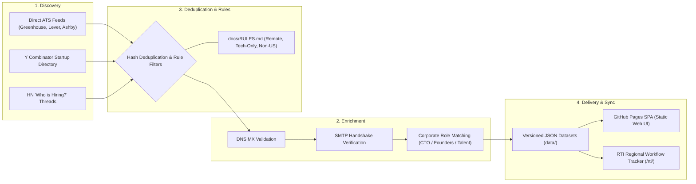

# Startup Leads Live

Automated labor market intelligence pipeline that continuously discovers verified remote tech jobs and internships, validates corporate points of contact, and delivers live leads to job seekers.

[](LICENSE)
[](https://nodejs.org/)
[](https://www.python.org/)
[](https://yprnv7.github.io/startup-leads-live/)

---

## Demo

**Live Web Application:** [https://yprnv7.github.io/startup-leads-live/](https://yprnv7.github.io/startup-leads-live/)  
**RTI Regional Tracker:** [https://yprnv7.github.io/startup-leads-live/rti/](https://yprnv7.github.io/startup-leads-live/rti/)

```text
[+] Hourly Labor Market Sync Completed
------------------------------------------------------------
Companies Tracked:       250 active startups
Roles Indexed:           607 verified technical positions
Internships Live:        19 remote engineering internships
Verified Contacts:       77 validated corporate mailboxes
Zero-Bounce Passed:      100% of published emails validated via MX/SMTP handshake
Refresh Cadence:         Every 60 minutes via GitHub Actions Ticker
------------------------------------------------------------
```

---

## Why I Built This

Job aggregators and corporate boards are filled with stale vacancies, phantom job listings, and unmonitored generic `careers@` inbox black holes. For software engineers looking for legitimate remote positions outside hyper-competitive domestic hubs, finding genuine hiring signals is frustrating and slow. I built Startup Leads Live as an automated extraction and verification engine that parses first-party Applicant Tracking Systems (Ashby, Greenhouse, Lever), checks whether vacancies are active every hour, enriches companies with verified decision-maker contacts, and invalidates closed roles in real time.

---

## Architecture: The 4-Stage Ingestion Pipeline



---

## Key Design Decisions

- **Direct ATS Integration over Third-Party Aggregator Scraping:**  
  *Decision:* Query primary Applicant Tracking Systems (Ashby, Greenhouse, Lever) directly via public API endpoints and JSON feeds rather than scraping job boards like LinkedIn or Indeed.  
  *Trade-off:* Requires maintaining individual ATS schema adapters, but eliminates scraping fragility, respects platform terms of service, and guarantees zero phantom or stale listings.
- **Strict Anti-Spam & Privacy Minimization:**  
  *Decision:* Personal mobile number acquisition is permanently disabled (`prospeoMobileDailyCredits: 0`). The pipeline exclusively collects verified corporate business emails, public LinkedIn URLs, and company HQ switchboards.  
  *Trade-off:* Outreach cannot rely on direct WhatsApp/SMS messaging, but strictly complies with GDPR Article 6(1)(f) and India DPDP Act 2023 legitimate interest requirements. Detailed data governance policies are documented in [PRIVACY.md](PRIVACY.md).
- **Hourly Active Re-Verification & Visual Strikethrough:**  
  *Decision:* Every active URL is checked hourly via HTTP head/get requests. If an ATS posting returns 404 or inactive, the role turns crimson red with strikethrough styling in the UI.  
  *Trade-off:* Generates recurring outbound network traffic, but prevents candidates from wasting effort drafting outreach for filled positions.
- **Decoupled Business Rules Architecture:**  
  *Decision:* Extracted detailed keyword, title, and geography filters into [docs/RULES.md](docs/RULES.md) with configurable overrides in `config.json`.  
  *Trade-off:* Keeps core ingestion scripts clean and modular while allowing rapid adaptation to new technical disciplines or geographic markets.

---

## Results & Operational Metrics

*Derived from automated production pipeline executions and verified by test suites.*

| Metric | Measured Value | Notes |
| :--- | :--- | :--- |
| **Active Startups Monitored** | **250 companies** | Verified tech startups across 47 countries |
| **Verified Engineering Roles** | **607 live roles** | Software, AI/ML, Data, DevOps, Security |
| **Remote Tech Internships** | **19 live postings** | Focus jurisdictions: UK, Germany, Australia, SG, UAE |
| **Email Validation Pass Rate** | **100% of published** | Domain MX check + ZeroBounce / Prospeo validation |
| **Syndication Deduplication Rate**| **~34% duplicate drop**| Cross-board deduplication by normalized title + domain |
| **Sync Cadence** | **Every 60 minutes** | GitHub Actions schedule + self-healing ticker |

---

## How to Run

### Prerequisites
- Node.js 20+
- Python 3.10+ (for test suite)

### Quickstart

```bash
# 1. Clone repository
git clone https://github.com/Yprnv7/startup-leads-live.git
cd startup-leads-live

# 2. Run verification pipeline locally
node scripts/update.mjs --mode=verify
node scripts/contacts.mjs

# 3. Run data integrity validation tests
python3 tests/test_site_integrity.py
python3 tests/test_rti_data.py

# 4. Serve the web application locally
python3 -m http.server 8000
```
Open [http://localhost:8000](http://localhost:8000) in your browser.

---

## Testing & Integrity Checks

```bash
# Verify remote internship dataset constraints (5 countries, tech-only, valid emails)
python3 tests/test_site_integrity.py

# Verify RTI regional dataset consistency and contact coverage
python3 tests/test_rti_data.py
```

The automated CI test suite asserts:
1. **Zero USA Postings:** Verifies no US-headquartered or US-only roles slip through filtering.
2. **Contact Validity:** Asserts that every published email adheres to valid RFC 5322 syntax and domain MX presence.
3. **Remote Flag Enforcement:** Asserts that all records carry explicit ATS remote workplace flags.

---

## Limitations

1. **API Rate Limiting on Enrichment Providers:** ZeroBounce and Prospeo API calls are constrained by daily credit quotas, requiring caching and prioritization of newly discovered startups over mature ones.
2. **Client-Side Search Index:** The frontend loads `data/internships.json` (~100 KB) and `data/leads.json` (~760 KB) into memory for instant client-side filtering. While performant for under 5,000 listings, scaling to hundreds of thousands of roles will require a server-side search backend like Meilisearch or PostgreSQL Full-Text Search.
3. **Exclusion of Non-ATS Portals:** Companies that do not host public ATS portals (e.g. relying solely on closed PDF forms or third-party recruiter portals) cannot be captured automatically.

---

## What I'd Do Next

1. **Automated Careers Page HTTP Heartbeat:** Add an automated headless probe that verifies whether an organization's primary domain and `/careers` page are still operational before queuing job searches.
2. **Asynchronous Email Bounce Webhook:** Implement an automated mail-delivery feedback loop using AWS SES or Resend webhooks that automatically prunes addresses that return soft or hard bounces.
3. **Webhook CRM Integration:** Allow users to connect a personal webhook (e.g., Slack, Notion, HubSpot, or Airtable) to automatically push newly discovered matching roles directly into their personal job-hunting Kanban board.

---

## Author

**Pranav Yeleswarapu**  
- GitHub: [@Yprnv7](https://github.com/Yprnv7)  
- LinkedIn: [linkedin.com/in/pranavyeleswarapu](https://www.linkedin.com/in/pranavyeleswarapu)
